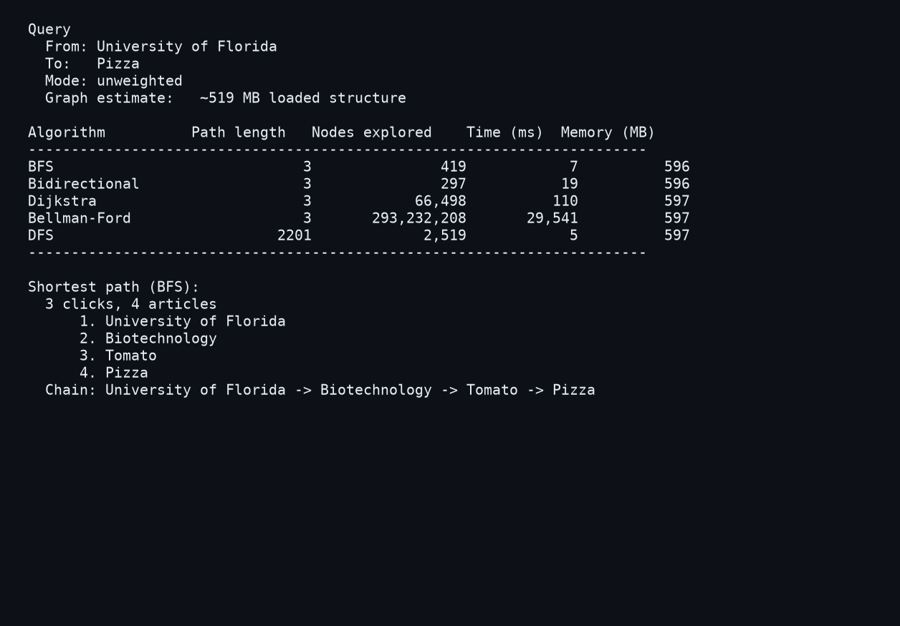
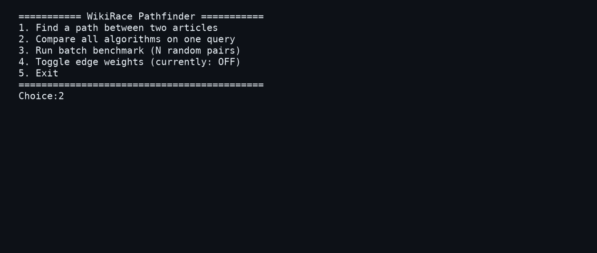
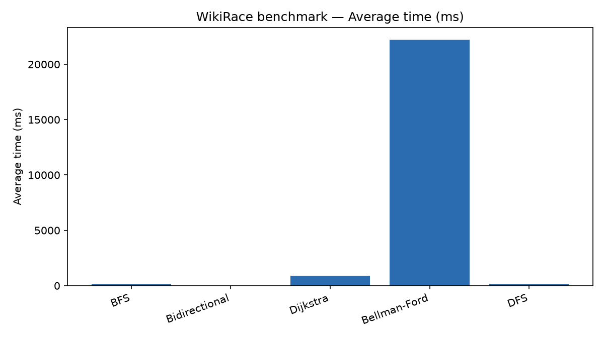
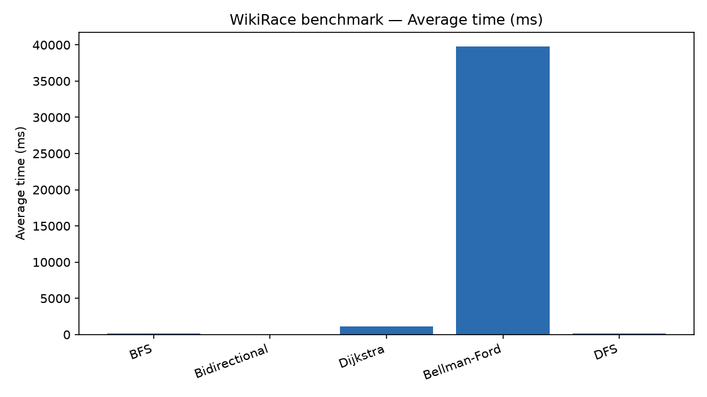
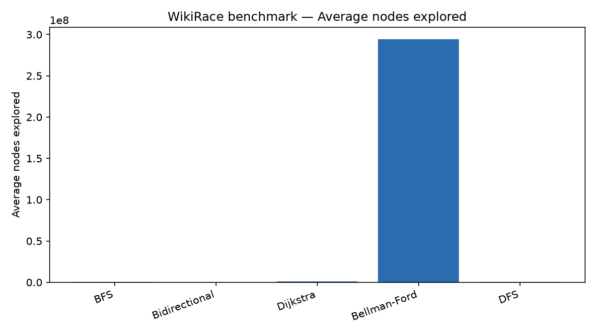

<!-- Badges -->
<p align="center">
  <a href="https://isocpp.org/"></a>
  <a href="https://cmake.org/"></a>
  <a href="https://www.python.org/"></a>
</p>
<p align="center">
  <a href="https://snap.stanford.edu/data/wiki-topcats.html"></a>
  <a href="https://github.com/RyanXi11/Hyperlink-Hustlers"></a>
</p>

---

<h1 align="center">🔗 WikiRace Pathfinder</h1>

<p align="center">
  <strong>Same query. Five algorithms. Two million articles.</strong>
</p>

<p align="center">
  A COP3530 pathfinding lab on the real Wikipedia link graph: load 1.79 million articles and 28.5 million hyperlinks,
  then race from any start title to any target using only links — while we measure who actually wins on time and nodes explored.
  Everything is from scratch in C++17: no graph library, no <code>std::unordered_map</code> for titles, no <code>std::priority_queue</code> for Dijkstra.
</p>

<p align="center">
  <a href="https://github.com/RyanXi11/Hyperlink-Hustlers"></a>
</p>

<p align="center">
  
</p>
<p align="center">
  <sub>Unweighted query on the full wiki-topcats graph (~1.79M articles). Regenerate with <code>python scripts/generate_readme_assets.py</code>.</sub>
</p>

---

## Overview

WikiRace is the game where you jump from article to article using only in-page links. **WikiRace Pathfinder** treats Wikipedia as a **directed graph** (articles = vertices, links = edges) and runs **BFS**, **bidirectional BFS**, **DFS**, **Dijkstra** (custom binary min-heap), and **Bellman-Ford** on the **same** start/target pairs.

We use Stanford SNAP’s [wiki-topcats](https://snap.stanford.edu/data/wiki-topcats.html) dataset. In **unweighted** mode every click costs 1 — the right tools minimize hops. In **weighted** mode, landing on obscure pages costs more, so Dijkstra and Bellman-Ford optimize total **cost**, not click count. Batch benchmarks write CSVs; a small Python script turns them into report charts.

**Hyperlink Hustlers:** Ryan Xi (graph, weights, data tooling), Vinh Nguyen (BFS, bi-BFS, DFS, heap, Dijkstra), Daniel Gao (Bellman-Ford, menu, benchmarks, video).

---

## How It Works

1. **Download the graph** — `scripts/download_data.ps1` pulls the edge list and titles into `data/` (gitignored; too large for GitHub).
2. **Build** — CMake produces `wikirace`, `graph_stats`, and `graph_tests`.
3. **Query by title** — Type start and target article names; the custom hash map resolves them to ids.
4. **Compare algorithms** — Menu option 2 runs all five on one pair and prints a side-by-side table.
5. **Benchmark at scale** — Option 3 runs every algorithm on *N* random pairs (default 100), writes `benchmark_results.csv` / `benchmark_summary.csv`, and logs averages.
6. **Toggle weights** — Option 4 switches unweighted vs in-degree–based costs without reloading.
7. **Charts for the report** — `python scripts/summarize_benchmark.py …` → bar charts in `output/`.

---

## Key Features

- **Five algorithms, one graph API** — Same adjacency lists and title map for every search; fair timing on identical queries.
- **Bidirectional BFS** — Forward and **reverse** adjacency lists so search meets in the middle on million-vertex graphs.
- **Custom TitleMap** — FNV-1a hashing, open addressing, linear probing; duplicate titles resolve to the lowest id.
- **Per-vertex weights** — `1 + log2(maxInDegree / inDegree)` stored once per article (~14 MB), not on every edge.
- **Honest baselines** — DFS finds *a* path; Bellman-Ford is correct but shows why O(VE) dies on SNAP-scale data.
- **Batch + memory column** — CSV includes nodes explored, milliseconds, and Windows working-set MB (graph-dominated ~600 MB).
- **Subgraph fallback** — Weakly connected induced subgraph when you cap vertices (`graph_stats --max-vertices`).
- **Tests without terabytes** — `ctest` uses `tests/fixtures/` only; no download required for unit tests.

### Programs

| Program | Role |
|---------|------|
| `wikirace.exe` | Interactive menu: path, compare, benchmark, weights |
| `graph_stats.exe` | Load stats, weight range, `--lookup`, optional subgraph |
| `graph_tests` | Unit tests on tiny graphs |

### WikiRace menu

| Option | What it does |
|--------|----------------|
| **1** | One path — BFS (unweighted) or Dijkstra (weighted) |
| **2** | All five algorithms + shortest path + timing table |
| **3** | Random-pair batch → CSV + terminal averages |
| **4** | Toggle weighted mode |
| **5** | Exit |

<p align="center">
  
</p>

---

## Engineering Highlights

**Loading 28M edges without STL graph baggage.** Edges stream in from disk with a degree-counting pass so adjacency vectors are reserved before fill. Forward and reverse lists stay in sync for bi-BFS. Titles load in a second pass into a custom map — the assignment forbids leaning on `std::unordered_map` for the title index.

**Weights on destinations, not edges.** Obscurity is a property of the *page you land on*, so we precompute vertex weights once after in-degrees are known and `edgeWeight(u,v)` reads the target’s cost. Subgraphs copy those weights instead of recomputing from partial in-degrees.

**Why bidirectional BFS wins on the full graph.** On random unweighted pairs, BFS and bi-BFS agree on hop count (~5–6), but bi-BFS explores on the order of **hundreds** of nodes vs **hundreds of thousands** for one-direction BFS — same shortest path, different constant factor in practice.

**Bellman-Ford as a deliberate anti-pattern at scale.** With unit weights it still finds shortest hop counts, but batch averages land around **tens of seconds** and **hundreds of millions** of relaxations per pair. Keeping it in the binary makes the report’s argument for Dijkstra/BFS visual, not theoretical.

**Benchmark artifacts stay local.** Root-level `benchmark_results*.csv`, `output/`, and `docs/` are gitignored; regenerate with menu option 3 and the summarize script. Checked-in charts under `assets/readme/` are updated via `scripts/generate_readme_assets.py` after a new batch run.

---

## Benchmark snapshots

Batch averages from menu option 3 (100 random pairs). Full PNGs also land in `output/` when you run `summarize_benchmark.py`.

<p align="center"><strong>Unweighted</strong></p>
<p align="center">
  
  &nbsp;&nbsp;
  
</p>

<p align="center"><strong>Weighted</strong></p>
<p align="center">
  
  &nbsp;&nbsp;
  
</p>

---

## Tech Stack

### Core
- **C++17** — Graph, algorithms, CLI
- **CMake + CTest** — Build and `graph_tests`

### Data
- **SNAP wiki-topcats** — 1,791,489 vertices, 28,511,807 edges ([dataset page](https://snap.stanford.edu/data/wiki-topcats.html))

### Report tooling
- **Python 3 + matplotlib** — `scripts/summarize_benchmark.py`, `scripts/generate_readme_assets.py`

### Tested environment
- **Windows / MSYS2 MinGW** — `g++` 15.2; ~**600 MB** RAM for the full graph

---

## Getting Started

### Prerequisites

- C++17 compiler and CMake 3.16+
- ~600 MB free RAM (full graph)
- PowerShell (data download script)

### Installation

Clone the repository:

```powershell
git clone https://github.com/RyanXi11/Hyperlink-Hustlers.git
cd Hyperlink-Hustlers
```

Download data (once per machine):

```powershell
powershell -ExecutionPolicy Bypass -File scripts/download_data.ps1
```

| File | Size | Contents |
|------|------|----------|
| `data/wiki-topcats.txt` | ~422 MB | `source_id target_id` per line |
| `data/wiki-topcats-page-names.txt` | ~47 MB | `article_id title` per line |

`data/` is gitignored (edge list exceeds GitHub’s file limit). The script skips files that already exist.

Build and test:

```powershell
cmake -S . -B build -G "MinGW Makefiles"
cmake --build build
ctest --test-dir build --output-on-failure
```

Run from the repo root (`wikirace` loads `data/wiki-topcats.txt` relative to cwd):

```powershell
.\build\wikirace.exe
```

After batch runs (menu option 3 — unweighted, then toggle weights and run again if you want weighted charts):

```powershell
pip install matplotlib
python scripts/generate_readme_assets.py
```

That summarizes any `benchmark_results*.csv` it finds, writes tagged charts under `output/` (`*_unweighted.png` / `*_weighted.png`), runs the UF→Pizza demo for screenshots, and copies charts into `assets/readme/`. To only refresh charts without reloading the graph (~30s):

```powershell
python scripts/generate_readme_assets.py --skip-demo
```

Or summarize one CSV manually:

```powershell
python scripts/summarize_benchmark.py benchmark_results.csv
```

Inspect the loaded graph:

```powershell
.\build\graph_stats.exe data\wiki-topcats.txt data\wiki-topcats-page-names.txt
```

| Flag | What it does |
|------|----------------|
| `--lookup TITLE` | Id, out-degree, in-degree, weight (case-sensitive; repeatable) |
| `--max-vertices N` | Also build/report a connected subgraph of `N` vertices |
| `--seed ID` | Subgraph seed (default: highest out-degree vertex) |

---

## Weighted Mode

In weighted mode, a link costs more when its destination is obscure (lower in-degree):

```
weight(v) = 1 + log2(maxInDegree / inDegree(v))
```

`maxInDegree` = 238,040 (**United States**). In-degree 0 (subgraphs/tests) is treated as 1. Unweighted mode sets every `edgeWeight` to **1**; Dijkstra and Bellman-Ford should match BFS hop counts as a sanity check.

| Article | In-degree | Weight |
|---------|-----------|--------|
| United States | 238,040 | 1.00 |
| Florida | 12,847 | 5.21 |
| University of Florida | 2,507 | 7.57 |
| Pizza | 315 | 10.56 |
| Any article with one in-link | 1 | 18.86 |

Weights range from 1.00 to 18.86 (mean ~16.82 on the full graph).

---

## Data Format

| Field | Type | Source | Meaning |
|-------|------|--------|---------|
| `source_id` | int | `wiki-topcats.txt` | Article the link is on |
| `target_id` | int | `wiki-topcats.txt` | Article the link points to |
| `article_id` | int | page-names file | Unique id, 0 … 1,791,488 |
| `title` | string | page-names file | Title; may contain spaces |

The loader accepts space-, tab-, or comma-separated ids and skips `#` / `%` comment lines. Everything after the first space on a name line is the title. **Self-loops:** 3,666 kept in data; searches should skip them. **Duplicate titles:** 892 titles map to multiple ids; `idForTitle` returns the lowest id.

---

## Project Structure

```
Hyperlink-Hustlers/
├── assets/readme/          README screenshots and benchmark PNGs (tracked)
├── include/graph/          Graph.h, TitleMap.h
├── src/graph/              Loader, adjacency, weights, subgraph, Algorithms.cpp
├── src/tools/              wikirace.cpp, graph_stats.cpp
├── tests/                  graph_tests + fixtures/
├── scripts/                download_data.ps1, summarize_benchmark.py, generate_readme_assets.py
├── data/                   SNAP files (gitignored)
├── output/                 benchmark PNGs (gitignored)
└── CMakeLists.txt
```

### Graph API

```cpp
#include "graph/Graph.h"

Graph graph;
if (!graph.loadEdges("data/wiki-topcats.txt") ||
    !graph.loadTitles("data/wiki-topcats-page-names.txt")) {
    std::cerr << graph.lastError() << "\n";
    return 1;
}

int start = graph.idForTitle("University of Florida");
int target = graph.idForTitle("Pizza");

for (int next : graph.outNeighbors(start)) { /* forward */ }
for (int prev : graph.inNeighbors(target)) { /* bidirectional BFS */ }

graph.setWeighted(true);
double cost = graph.edgeWeight(start, target);
```

`inducedConnectedSubgraph(seed, n)` grows a weakly connected subgraph of `n` vertices and remaps ids (optional fallback when memory is tight; full graph ~520 MB estimated).

---

## Credits

- **J. Leskovec and A. Krevl, SNAP** — [wiki-topcats](https://snap.stanford.edu/data/wiki-topcats.html)
- **Course** — COP3530 Project 2 (University of Florida)
- **Team** — Vinh Nguyen, Ryan Xi, Daniel Gao

---

## Contact

| Member | Focus |
|--------|--------|
| **Ryan Xi** | Graph load, TitleMap, weights, README, benchmark tooling |
| **Vinh Nguyen** | BFS, bi-BFS, DFS, min-heap, Dijkstra |
| **Daniel Gao** | Bellman-Ford, menu, batch UX, results, video |

---

## Future Ideas

**Features**

- [ ] Case-insensitive title lookup with explicit disambiguation for duplicate titles
- [ ] Export path as a title chain for demos and the project video

**Improvements**

- [ ] Cross-platform memory metric (benchmarks use Windows working set today)
- [ ] Configurable batch size on low-RAM machines

---

<p align="center">
  <em>Built to make algorithm choice obvious — on a graph you can’t fit in a slide deck.</em>
</p>
